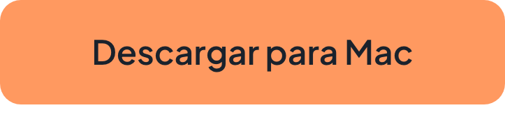
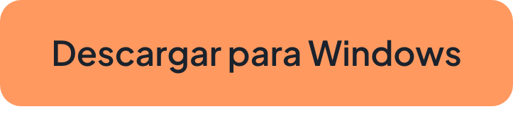

# Blave Agent

## Espacio de trabajo quant para agentes de IA

Crea, haz backtest y opera estrategias en vivo con Claude Code o Codex. Gratis y de código abierto.

[English](README.md) | [繁體中文](README.zh-TW.md) | [简体中文](README.zh-CN.md) | [日本語](README.ja.md) | **Español** | [Português](README.pt.md) | [Tiếng Việt](README.vi.md)

<a href="https://download.blave.org/desktop/mac/Blave-universal.dmg"></a>&nbsp;&nbsp; <a href="https://download.blave.org/desktop/win/Blave-Setup.exe"></a>

> Esta traducción parte del README en inglés en el commit [`b2584e3`](https://github.com/Blave-TW/blave-agent/blob/b2584e3/README.md) y cubre solo las secciones que cambian poco. Los exchanges y datos, la nube, la estructura del repositorio, cómo contribuir y las notas para mantenedores están en la [versión en inglés](README.md). Si algo no coincide, prevalece el original en inglés.

https://github.com/user-attachments/assets/7b33edb7-9c65-4e19-854a-40295c6e8b74

[Inicio rápido](#quick-start) · [Que siga funcionando con el PC apagado](https://blave.org/agent/es)

Si te resulta útil, dale una estrella al repositorio, y activa Watch › Releases para enterarte de cada versión nueva.

## Qué lo hace diferente

Claude Code o Codex pueden escribir un bot de trading. Lo difícil es ponerlo a operar de verdad. En una terminal, cada estrategia es una carpeta de scripts y un historial de chat, y en cuanto hay unas cuantas cuesta seguirles la pista. Montar tu propio trading automático implica encargarte tú mismo de la programación de tareas, las API de los exchanges, la conciliación de posiciones, los reinicios y las claves. Blave Agent es esa pieza que falta.

### Tus estrategias en una sola app, no en scripts dispersos


Cada estrategia está en la barra lateral con su backtest, sus operaciones, su barrido de parámetros, su prueba fuera de muestra, su código y sus versiones guardadas. Restaura una versión anterior desde la lista y fija cuánto opera cada estrategia en la página **Portfolio** (Portafolio).

### Trading automático ya conectado

- **Conecta un exchange:** Binance, OKX, Bybit, BingX, Gate.io, o President Futures en Windows. La clave se comprueba primero con el exchange, y una clave que puede retirar fondos se rechaza (Gate.io no informa de este permiso, así que compruébalo tú).
- **Fija un monto y pulsa Start trading (Iniciar trading).** La app ejecuta cada estrategia según su calendario y lleva la cuenta hacia sus posiciones objetivo. Cada intento de orden queda registrado (`state/audit.jsonl`).
- **Pause trading (keep positions)** (Pausar trading, conservar posiciones) desde la barra de menús (bandeja del sistema en Windows). Tras cerrar y volver a abrir la app, nada opera hasta que vuelvas a pulsar **Start trading**.
- **El paper trading** no necesita claves.

### Backtests que comprueban el sobreajuste y usan comisiones reales

Sobreajuste: parámetros que solo por casualidad encajan con los datos pasados.

- **Valor p de MCPT** en cada backtest de Tipo A (`lib/validation.py`): ¿unos datos barajados podrían haberlo hecho igual de bien?
- **Barrido de parámetros** en busca de una meseta, no de la mejor celda aislada (`lib/param_scan.py`); **walk-forward** para resultados fuera de muestra (`lib/walk_forward.py`).
- **Comisiones reales:** una comisión de 0 genera un aviso (`lib/quality_check.py`).
- **Una idea, un backtest:** un mal resultado se informa tal cual, sin reajustarlo a escondidas (*Iteration Brakes* en [`AGENTS.md`](AGENTS.md)).

### ¿Sin ideas? Busca en la web por ti


Pulsa **Search the Web for Ideas** (Buscar ideas en la web) y el agente lee una docena de sitios y vuelve con tres ideas que se pueden someter a backtest, cada una con sus reglas de entrada y salida y la URL de su fuente. Elige una y la construye y le hace el backtest. Las páginas que lee se abren en el navegador integrado de la app, en tu pantalla; las páginas de cuenta de los exchanges y las direcciones de redes privadas están bloqueadas.

<a id="quick-start"></a>

## Inicio rápido

Descarga la app para [macOS](https://download.blave.org/desktop/mac/Blave-universal.dmg) o [Windows](https://download.blave.org/desktop/win/Blave-Setup.exe) (macOS 13 o posterior, o Windows 10/11 x64) y ábrela.

En el primer inicio eliges qué impulsa al agente:

- **Tu propio Claude Code o Codex.** No hace falta una cuenta de Blave; Blave no cobra nada por la IA.
- **Tu propia clave de DeepSeek.** DeepSeek te cobra directamente. La clave se queda en el llavero de este equipo y nunca llega al agente.
- **Blave AI.** Inicia sesión con una cuenta de Blave; se cobra por uso.

Después, describe una idea:

- «Haz un backtest de BTCUSDT en el gráfico de 4h: largo cuando la SMA de 20 periodos cruce por encima de la SMA de 60, fuera del mercado cuando vuelva a cruzar por debajo. Usa una comisión del 0.05% por lado.»
- «Barre las dos longitudes de SMA de esa estrategia y muéstrame dónde está la meseta.»

Antes de escribir código, el agente clasifica cada idea en uno de tres tipos:

| Tipo | Qué es | Backtest |
|---|---|---|
| A | Un símbolo fijo en un intervalo fijo; una posición (largo / corto / fuera) | Obligatorio |
| C | Un portafolio: N símbolos y un vector de pesos que suma como máximo 1, rebalanceado según un calendario | Obligatorio |
| B | Todo lo demás: screeners, grids, arbitraje, alertas, ejecución puntual | Ninguno |

<details>
<summary>Notas por plataforma</summary>

- La app empaquetada para macOS es una compilación universal (Apple Silicon e Intel). Windows: las versiones que soporta Electron 44; ARM no está probado. El instalador de Windows aún no tiene firma de código, así que SmartScreen avisa en la primera instalación: elige More info › Run anyway (Más información › Ejecutar de todas formas).
- Versión de Node.js: `shell/package.json` › `engines`. La app empaquetada trae su propio Python 3.12; al ejecutar desde el código fuente se usa el Python de tu sistema (`python3`, o `python` en Windows) para crear el venv.
- Codex viene dentro de la app de ChatGPT: «ChatGPT» de Microsoft Store en Windows (`winget install --id 9PLM9XGG6VKS -s msstore`), ChatGPT.app en Mac. En Windows, por ahora evita las compilaciones 0.161–0.162.1 de `@openai/codex` de npm (su sandbox está roto).
- Con tu propio Claude Code o Codex, la app solo lanza el CLI; tus credenciales se quedan con él. Una clave de DeepSeek se guarda cifrada en Windows, y la app reenvía las solicitudes del agente en local.
- `npm.cmd` funciona aunque la directiva de ejecución de PowerShell bloquee el script `npm`.
- La interfaz sigue el idioma del sistema (inglés o chino tradicional). Para forzarlo: `BLAVE_LANG=en npm start` (PowerShell: `$env:BLAVE_LANG="en"; npm.cmd start`).

</details>

### Desde el código fuente

Necesitas macOS 13 o superior o Windows 10/11 (x64), Node.js 22.12 o superior, Python 3 en tu `PATH`, y una de estas opciones: Claude Code o Codex con sesión iniciada, una clave de API de DeepSeek, o una cuenta de Blave.

```
git clone https://github.com/Blave-TW/blave-agent.git
cd blave-agent/shell
npm install
npm start
```

En Windows, ejecuta `npm.cmd install` y `npm.cmd start` en PowerShell.

## Novedades

Los cambios de cada versión están en [Releases](https://github.com/Blave-TW/blave-agent/releases).

## Seguridad y límites

- **Claves:** otórgales solo permisos de lectura y trading. Una clave con permiso de retiro se rechaza al conectarla (Binance, OKX, BingX, Bybit); Gate.io no informa de ese permiso, así que compruébalo tú mismo. Las claves viven en el `.env` del espacio de trabajo en tu ordenador (`~/Blave/workspace/.env`, `%USERPROFILE%\Blave\workspace\.env` en Windows) o en tu propio servidor en la nube, o las guarda Blave cifradas cuando las vinculas en la página web. El agente puede leer ese `.env`; sus reglas le prohíben mostrar los valores de las claves (`references/exchange-connect.md`).
- **Los montos a invertir y la reanudación del trading los haces tú,** en la página Auto trading (Trading automático) de la app de escritorio o en el espacio de trabajo web. El agente se niega a hacerlo, aunque se lo pidas; lo único que siempre puede hacer por su cuenta es activar el kill switch.
- **En la app de escritorio, las órdenes solo salen mientras Blave está abierto.** Después de cerrarlo y volver a abrirlo, el trading queda en pausa hasta que pulses **Start trading**.
- **Verificado antes de informar:** el agente consulta una orden en el exchange antes de decir que se colocó, y cada intento queda registrado en `state/audit.jsonl`.
- Un backtest describe el pasado. MCPT y los barridos de parámetros reducen la probabilidad de que lo que ves sea suerte; no la eliminan. Nada de esto constituye asesoramiento de inversión, y operar puede hacerte perder todo tu dinero.

## Política de firma de código

La versión de Windows aún no tiene firma de código: hemos solicitado el programa de código abierto de [SignPath Foundation](https://signpath.org) y, hasta que lo aprueben, el instalador de Windows no está firmado. Una vez aprobado: firma de código gratuita en Windows proporcionada por [SignPath.io](https://signpath.io), con certificado de SignPath Foundation. Las versiones se compilan con el flujo público de GitHub Actions de este repositorio a partir de un commit con tag; cada solicitud de firma la aprueba el propietario del repositorio. Roles: autores y revisores, los mantenedores con permiso de escritura; aprobador, el propietario del repositorio. Este programa no transferirá ninguna información a terceros, salvo lo descrito en la [política de privacidad](https://blave.org/disclaimer/es/privacy_policy). La versión de macOS está firmada y notarizada con la identidad de Apple propia de Blave.

## Licencia

**Apache-2.0**: consulta [`LICENSE`](LICENSE) y [`NOTICE`](NOTICE). Puedes usarlo, modificarlo y redistribuirlo, también con fines comerciales; incluye una concesión de patentes. «Blave» y el logotipo de Blave son marcas comerciales: cambia el nombre de tu fork.

**Las estrategias que escribes son tuyas.** Todo lo que esté dentro de `strategies/` no forma parte de este proyecto y la licencia no lo alcanza. Las partes de pago —los servidores en la nube, los datos de mercado y el proxy de LLM de Blave— son servicios de blave.org y no están en este repositorio.

Claude Code y Codex son productos de sus respectivos propietarios. Blave Agent no está afiliado a ellos ni cuenta con su respaldo.

---

## Para mantenedores y máquinas existentes

Las notas para mantenedores están en la versión en inglés: [README.md › For maintainers and existing machines](README.md#for-maintainers-and-existing-machines)
