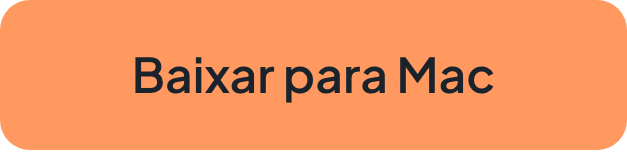
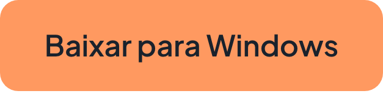

<div align="center">


# Blave Agent

**Espaço de trabalho quant para agentes de IA**<br>
Crie, faça backtest e opere estratégias ao vivo com Claude Code ou Codex. Grátis e de código aberto.

<a href="https://github.com/Blave-TW/blave-agent/releases"></a>

[English](README.md) | [繁體中文](README.zh-TW.md) | [简体中文](README.zh-CN.md) | [日本語](README.ja.md) | [Español](README.es.md) | **Português** | [Tiếng Việt](README.vi.md)

<a href="https://download.blave.org/desktop/mac/Blave-universal.dmg"></a>&nbsp;&nbsp; <a href="https://download.blave.org/desktop/win/Blave-Setup.exe"></a>

</div>

> Traduzido do README em inglês no commit [`593f8b3`](https://github.com/Blave-TW/blave-agent/blob/593f8b3/README.md). Se algo divergir, vale o original em inglês.

https://github.com/user-attachments/assets/7b33edb7-9c65-4e19-854a-40295c6e8b74

<p align="center"><a href="https://blave.org/docs/pt">Documentação</a></p>

## O que você ganha

- **Todas as suas estratégias em um só app.** Backtest, operações, varredura de parâmetros e versões de cada uma.
- **Backtests que apontam overfitting.** p-valor MCPT, platô de parâmetros e walk-forward.
- **Taxas reais por padrão.** Uma taxa de 0 gera um aviso.
- **Trading automático já conectado.** Binance, OKX, Bybit, BingX, Gate.io, Bitget, StockCoin e futuros de índice de Taiwan no Windows.
- **Paper trading.** Sem chaves.
- **Ideias da web.** O agente lê alguns sites e traz três que você pode testar.
- **Escolha sua IA.** Claude Code, Codex, uma chave DeepSeek ou Blave AI.


<p align="center">⭐ Se isso te poupar um fim de semana de integração, dê uma estrela. Ajuda outros traders a encontrá-lo.</p>

<a id="quick-start"></a>

## Início rápido

1. Baixe a versão para [macOS](https://download.blave.org/desktop/mac/Blave-universal.dmg) ou [Windows](https://download.blave.org/desktop/win/Blave-Setup.exe) e abra.
2. Escolha sua IA.
3. Descreva uma ideia:

> Faça o backtest de BTCUSDT no gráfico de 4h: comprado quando a SMA 20 cruzar acima da SMA 60, zerado quando cruzar de volta. Taxa de 0,05% por lado.

<details><summary>Notas de plataforma</summary>

macOS 13+ (build universal) ou Windows 10/11 x64. O instalador do Windows ainda não tem assinatura de código: escolha Mais informações › Executar assim mesmo.

</details>

<details><summary>Compilar a partir do código-fonte</summary>

Você precisa de Node.js 22.12+ e Python 3 no seu `PATH`.

```
git clone https://github.com/Blave-TW/blave-agent.git
cd blave-agent/shell
npm install
npm start
```

No Windows, rode `npm.cmd install` e `npm.cmd start` no PowerShell.

</details>

## Segurança

- **Só você aloca fundos ou retoma o trading.** O agente só pode pará-lo.
- **Cada ordem é conferida com a exchange** e registrada em `state/audit.jsonl`.
- **Um backtest descreve o passado.** O trading pode fazer você perder todo o seu dinheiro.

Exchanges e chaves: [documentação](https://blave.org/docs/pt/exchange_api) · Fontes de dados: [cripto](https://blave.org/docs/pt/data_crypto), [ações de Taiwan](https://blave.org/docs/pt/data_twstock)

## Rode na nuvem (pago)

Suas estratégias continuam rodando com o PC desligado, e você fala com elas pela web ou pelo Telegram. [Planos](https://blave.org/agent/pt)

## Novidades

Cada versão: [Releases](https://github.com/Blave-TW/blave-agent/releases). Use Watch › Releases para receber avisos.

## Para desenvolvedores

<details><summary>Estrutura do repositório, testes, como contribuir</summary>

Comece por `AGENTS.md`, depois `examples/README.md` e `references/lib.md`. Em `tests/` há um arquivo por contrato. Antes de um PR, rode os testes que cobrem sua mudança e `pre-commit install`.

</details>

## Licença

Apache-2.0. As estratégias que você escreve são suas. "Blave" é uma marca: renomeie o seu fork.

Claude Code e Codex são produtos de seus respectivos donos. O Blave Agent não é afiliado a eles nem endossado por eles.

## Política de assinatura de código

A versão para Windows ainda não tem assinatura de código: solicitamos o programa de código aberto da [SignPath Foundation](https://signpath.org) e, até a aprovação, o instalador do Windows não é assinado. Depois de aprovado: assinatura de código gratuita no Windows fornecida pela [SignPath.io](https://signpath.io), com certificado da SignPath Foundation. As versões são compiladas pelo workflow público do GitHub Actions deste repositório a partir de um commit com tag; cada pedido de assinatura é aprovado pelo dono do repositório. Papéis: autores e revisores, os mantenedores com permissão de escrita; aprovador, o dono do repositório. Este programa não transferirá nenhuma informação a terceiros, exceto conforme descrito na [política de privacidade](https://blave.org/disclaimer/pt/privacy_policy). A versão para macOS é assinada e notarizada com a identidade Apple da própria Blave.

---

## Para mantenedores e máquinas existentes

As notas para mantenedores estão na versão em inglês: [README.md › For maintainers and existing machines](README.md#for-maintainers-and-existing-machines)
