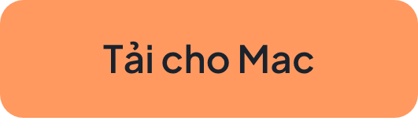

<div align="center">


# Blave Agent

**Không gian làm việc quant cho AI agent**<br>
Xây dựng chiến lược, backtest và giao dịch thật với Claude Code hoặc Codex. Miễn phí, mã nguồn mở.

<a href="LICENSE"></a> <a href="https://github.com/Blave-TW/blave-agent/releases"></a>  

[English](README.md) | [繁體中文](README.zh-TW.md) | [简体中文](README.zh-CN.md) | [日本語](README.ja.md) | [Español](README.es.md) | [Português](README.pt.md) | **Tiếng Việt**

<a href="https://download.blave.org/desktop/mac/Blave-universal.dmg"></a>&nbsp;&nbsp; <a href="https://download.blave.org/desktop/win/Blave-Setup.exe"></a>

</div>

> Bản dịch từ README tiếng Anh tại commit [`ec42107`](https://github.com/Blave-TW/blave-agent/blob/ec42107/README.md). Nếu có chỗ khác nhau, bản gốc tiếng Anh là chuẩn.

https://github.com/user-attachments/assets/7b33edb7-9c65-4e19-854a-40295c6e8b74

<p align="center"><a href="#quick-start">Bắt đầu nhanh</a> · <a href="https://blave.org/docs/vi">Tài liệu</a> · <a href="https://blave.org/agent/vi">Vẫn chạy khi tắt máy</a></p>

## Bạn nhận được gì

- **Mọi chiến lược trong một ứng dụng.** Mỗi chiến lược có backtest, giao dịch, quét tham số và các phiên bản đã lưu.
- **Backtest cảnh báo overfitting.** p-value MCPT, vùng phẳng tham số và walk-forward.
- **Mặc định tính phí thật.** Phí bằng 0 sẽ bị cảnh báo.
- **Giao dịch tự động đã nối sẵn.** Binance, OKX, Bybit, BingX, Gate.io, cùng hợp đồng tương lai chỉ số Đài Loan trên Windows.
- **Giao dịch mô phỏng.** Không cần khóa.
- **Ý tưởng từ web.** Agent đọc khoảng mười mấy trang và mang về ba ý tưởng có thể backtest.
- **AI của riêng bạn.** Claude Code, Codex, khóa DeepSeek hoặc Blave AI.


<p align="center">⭐ Nếu nó giúp bạn tiết kiệm một cuối tuần nối API, hãy gắn sao cho repo. Như vậy trader khác dễ tìm thấy hơn.</p>

<a id="quick-start"></a>

## Bắt đầu nhanh

1. Tải bản cho [macOS](https://download.blave.org/desktop/mac/Blave-universal.dmg) hoặc [Windows](https://download.blave.org/desktop/win/Blave-Setup.exe) rồi mở ra.
2. Chọn AI: Claude Code hoặc Codex của bạn, khóa DeepSeek, hoặc Blave AI.
3. Mô tả một ý tưởng:

> Backtest BTCUSDT khung 4h: mua khi SMA 20 cắt lên SMA 60, đóng vị thế khi cắt xuống lại. Phí 0,05% mỗi chiều.

<details><summary>Ghi chú nền tảng</summary>

macOS 13+ (bản universal) hoặc Windows 10/11 x64. Bộ cài Windows chưa được ký mã: chọn More info › Run anyway.

</details>

<details><summary>Build từ mã nguồn</summary>

```
git clone https://github.com/Blave-TW/blave-agent.git
cd blave-agent/shell
npm install
npm start
```

</details>

## An toàn

- **Chỉ bạn mới nạp vốn hoặc tiếp tục giao dịch.** Agent chỉ có thể dừng.
- **Mọi lệnh đều được đối chiếu với sàn** và ghi vào `state/audit.jsonl`.
- **Backtest chỉ mô tả quá khứ.** Giao dịch có thể làm bạn mất toàn bộ số tiền.

Sàn và khóa: [tài liệu](https://blave.org/docs/vi/exchange_api) · Nguồn dữ liệu: [crypto](https://blave.org/docs/vi/data_crypto), [cổ phiếu Đài Loan](https://blave.org/docs/vi/data_twstock)

## Chạy trên đám mây (trả phí)

Chiến lược vẫn chạy khi bạn tắt máy, và bạn trò chuyện với chúng qua web hoặc Telegram. [Gói dịch vụ](https://blave.org/agent/vi)

## Tin mới

Mọi phiên bản: [Releases](https://github.com/Blave-TW/blave-agent/releases). Chọn Watch › Releases để nhận thông báo.

## Dành cho nhà phát triển

<details><summary>Cấu trúc thư mục, kiểm thử, đóng góp</summary>

Bắt đầu với `AGENTS.md`, rồi `examples/README.md` và `references/lib.md`. Trong `tests/`, mỗi hợp đồng một file. Trước khi gửi PR, chạy các kiểm thử liên quan đến thay đổi và `pre-commit install`.

</details>

## Giấy phép

Apache-2.0. Chiến lược bạn viết là của bạn. "Blave" là nhãn hiệu: hãy đổi tên bản fork của bạn.

## Chính sách ký mã

Bản Windows hiện chưa có chữ ký mã: chúng tôi đã đăng ký chương trình mã nguồn mở của [SignPath Foundation](https://signpath.org), và cho đến khi được duyệt, trình cài đặt Windows chưa được ký. Sau khi được duyệt: chữ ký mã miễn phí trên Windows do [SignPath.io](https://signpath.io) cung cấp, chứng chỉ do SignPath Foundation cấp. Các bản phát hành được build bởi workflow GitHub Actions công khai trong repo này từ một commit có gắn tag; mỗi yêu cầu ký đều do chủ sở hữu repo phê duyệt. Vai trò: tác giả và người review — các người bảo trì có quyền ghi; người phê duyệt — chủ sở hữu repo. Chương trình này sẽ không chuyển bất kỳ thông tin nào cho bên thứ ba, ngoại trừ như mô tả trong [chính sách quyền riêng tư](https://blave.org/disclaimer/vi/privacy_policy). Bản macOS được ký và notarize bằng danh tính Apple của chính Blave.

---

## Dành cho người bảo trì và các máy hiện có

Ghi chú cho người bảo trì xem ở bản tiếng Anh: [README.md › For maintainers and existing machines](README.md#for-maintainers-and-existing-machines)
