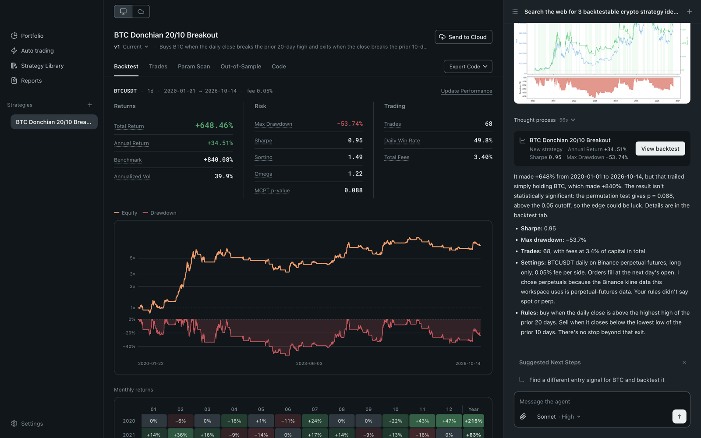
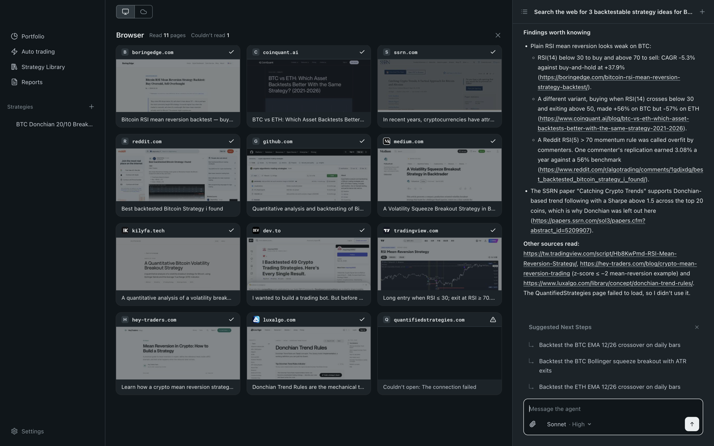

# Blave Agent

## 给 AI Agent 的量化工作台

用 Claude Code 或 Codex 写策略、跑回测、上线自动交易<br>
免费开源

[English](README.md) | [繁體中文](README.zh-TW.md) | **简体中文** | [日本語](README.ja.md) | [Español](README.es.md) | [Português](README.pt.md) | [Tiếng Việt](README.vi.md)

<a href="https://download.blave.org/desktop/mac/Blave-universal.dmg"></a>&nbsp;&nbsp; <a href="https://download.blave.org/desktop/win/Blave-Setup.exe"></a>

> 本文译自英文版 README 的 commit [`b2584e3`](https://github.com/Blave-TW/blave-agent/blob/b2584e3/README.md)，只涵盖变动较少的段落；交易场所与数据、云端主机、目录结构、贡献方式与维护者说明请看[英文版](README.md)。内容有出入时，以英文原文为准。

https://github.com/user-attachments/assets/66c747e9-b068-4da9-a372-84d9afa7cb0d

[快速开始](#quick-start) · [关电脑也照跑](https://blave.org/agent/cn)

觉得有用就点个 Star；想在新版发布时收到通知，请点 Watch › Releases。

## 跟别的交易 agent 不一样的地方

Claude Code 或 Codex 写得出交易 bot，难的是真的拿来跑。在终端里，每支策略都是一个文件夹的脚本加一段对话记录，策略一多就管不过来；自己接自动交易，调度、交易所 API、仓位对账、重启、密钥都得自己处理。Blave Agent 补的就是这一段。

### 策略收在一个 app 里，不是散落的脚本



各支策略都在侧边栏，点开就有回测、成交记录、参数扫描、样本外验证、代码与历史版本。旧版本可以从版本列表还原，每支策略交易多少金额在 **Portfolio** 页（策略组合）设置。

### 自动交易已经接好

- **连接交易所：** Binance、OKX、Bybit、BingX、Gate.io，Windows 上还有统一期货。密钥先拿去交易所验证，有提现权限的直接拒绝（Gate.io 查不到这一项，请自己确认）。
- **设好金额，点 Start trading（启动下单）。** app 按计划运行每支策略，把账户调到目标仓位。每一次下单尝试都记在 `state/audit.jsonl`。
- **Pause trading (keep positions)（暂停下单，不动仓位）** 在菜单栏（Windows 是系统托盘）。退出 app 再打开后，你没点 Start trading 之前不会下任何单。
- **模拟交易**不需要密钥。

### 回测先查过拟合，手续费照实算

过拟合，指参数只是刚好贴合过去的数据。

- **MCPT p 值：** 每次 Type A 回测都跑（`lib/validation.py`）——把数据打乱之后，能不能做出一样好的成绩？
- **参数扫描**找一整片有效的平台，不挑最高那一格（`lib/param_scan.py`）；**walk-forward** 衡量样本外表现（`lib/walk_forward.py`）。
- **手续费照实算：** 填 0 会被警告（`lib/quality_check.py`）。
- **一个想法只回测一次：** 结果不好就照实回报，不偷偷调参数（见 [`AGENTS.md`](AGENTS.md) 的 *Iteration Brakes*）。

### 没有灵感？它帮你上网找



点 **Search the Web for Ideas**（上网找点子），agent 会去读十几个网站，带回三个可以回测的思路，每个都写好进出场规则、附上来源网址。挑一个，它就帮你写成策略、跑回测。它读的页面都开在 app 内置的浏览器里，就在你的屏幕上；交易所账户后台与内网地址一律拦下。

<a id="quick-start"></a>

## 快速开始

下载 [macOS 版](https://download.blave.org/desktop/mac/Blave-universal.dmg)或[Windows 版](https://download.blave.org/desktop/win/Blave-Setup.exe)（macOS 13 及以上，或 Windows 10／11 x64），打开就能用。

第一次打开时，选 agent 用哪个 AI：

- **自己的 Claude Code 或 Codex。** 不需要 Blave 账号，Blave 不收 AI 费用。
- **自己的 DeepSeek 密钥。** DeepSeek 直接向你收费。密钥留在这台电脑的钥匙串，不会到 agent 手上。
- **Blave AI。** 登录 Blave 账号，按用量计费。

接着讲你的想法：

- 「回测 BTCUSDT 4 小时线：20 期 SMA 上穿 60 期 SMA 做多，跌回下方就空仓。手续费单边 0.05%。」
- 「把这支策略的两个 SMA 长度扫一遍，告诉我参数平台在哪。」

动手写代码之前，agent 会先判断想法属于哪一型：

| 类型 | 是什么 | 回测 |
|---|---|---|
| A | 单一标的、固定周期；一个仓位（多／空／空仓） | 必做 |
| C | 投资组合：N 个标的加一组权重（总和不超过 1），定期再平衡 | 必做 |
| B | 其余全部：选股器、网格、套利、警示、一次性下单 | 不做 |

<details>
<summary>平台说明</summary>

- macOS 打包版是通用版（Apple Silicon 与 Intel）。Windows 为 Electron 44 支持的版本，ARM 版尚未测试。Windows 安装文件还没有代码签名，第一次安装时 SmartScreen 会弹出警告：点 More info（更多信息）› Run anyway（仍要运行）。
- Node.js 版本见 `shell/package.json` › `engines`。打包版自带 Python 3.12；从源代码运行时，用你系统的 Python（`python3`，Windows 是 `python`）创建 venv。
- Codex 在 ChatGPT app 里：Windows 装 Microsoft Store 的「ChatGPT」（`winget install --id 9PLM9XGG6VKS -s msstore`），Mac 装 ChatGPT.app。Windows 上暂时不要用 npm 的 `@openai/codex` 0.161–0.162.1 版本（沙盒有问题）。
- 用自己的 Claude Code 或 Codex 时，app 只负责启动 CLI，登录凭证留在 CLI 自己手上。DeepSeek 密钥在 Windows 上加密存储，agent 的请求由 app 在本机转发。
- PowerShell 的执行策略挡下 `npm` 脚本时，`npm.cmd` 照样能跑。
- 界面语言跟着系统语言（英文或繁体中文）。要强制指定：`BLAVE_LANG=en npm start`（PowerShell：`$env:BLAVE_LANG="en"; npm.cmd start`）。

</details>

### 从源代码运行

需要 macOS 13 以上或 Windows 10／11（x64）、Node.js 22.12 以上、`PATH` 上有 Python 3，再加上其中之一：已登录的 Claude Code 或 Codex、一把 DeepSeek API 密钥，或一个 Blave 账号。

```
git clone https://github.com/Blave-TW/blave-agent.git
cd blave-agent/shell
npm install
npm start
```

Windows 在 PowerShell 里改跑 `npm.cmd install` 与 `npm.cmd start`。

## 最新消息

每一版改了什么，见 [Releases](https://github.com/Blave-TW/blave-agent/releases)。

## 安全与边界

- **密钥：** 只给读取＋交易权限。有提现权限的密钥在连接时会被拒绝（Binance、OKX、BingX、Bybit）；Gate.io 查不到这个标志，请自己确认。密钥放在你电脑上工作区的 `.env`（`~/Blave/workspace/.env`，Windows 是 `%USERPROFILE%\Blave\workspace\.env`）或你自己的云端主机上，在网页绑定的则由 Blave 加密保存。agent 读得到那份 `.env`，它的规则禁止打印密钥的值（`references/exchange-connect.md`）。
- **投入资金与恢复交易由你自己做，** 在电脑版的 Auto trading（自动下单）页或网页工作页。就算你开口要求，agent 也会拒绝；它唯一可以随时自己做的，是触发紧急停止。
- **电脑版只有在 Blave 运行时才会下单。** 退出再重新打开后，交易维持暂停，直到你点 Start trading（启动下单）。
- **先验证再回报：** 下完单会向交易所查回结果，agent 才说已下单；每一次下单尝试都记在 `state/audit.jsonl`。
- 回测讲的是过去。MCPT 与参数扫描能降低你看到的只是运气的概率，但不能消除。这里没有任何内容是投资建议；交易可能亏光你所有的钱。

## 代码签名政策

Windows 版目前还没有代码签名：我们已向 [SignPath Foundation](https://signpath.org) 的开源项目计划申请，核准前 Windows 安装文件未经签名。核准后，Windows 版的代码签名由 [SignPath.io](https://signpath.io) 免费提供，证书属于 SignPath Foundation。每个版本都由本 repo 的公开 GitHub Actions workflow 从打了 tag 的 commit 构建，每次签名由 repo 拥有者核准。角色：作者与审查者＝有写入权限的维护者；核准者＝repo 拥有者。除[隐私权政策](https://blave.org/disclaimer/cn/privacy_policy)所述外，本程序不会把任何信息传给第三方。macOS 版以 Blave 自己的 Apple 身份签名与公证。

## 授权

**Apache-2.0**——见 [`LICENSE`](LICENSE) 与 [`NOTICE`](NOTICE)。可以自由使用、修改、分发，含商业用途；含专利授权。「Blave」与 Blave 标志是商标：fork 请改名。

**你写的策略是你的。** `strategies/` 底下的东西不属于本项目，授权不及于它。付费的部分——云端主机、市场数据与 Blave 的 LLM proxy——是 blave.org 的服务，不在这个 repo 里。

Claude Code 与 Codex 是各自所有者的产品；Blave Agent 与它们没有合作或背书关系。

---

## 给维护者与既有机器

维护者说明见英文版：[README.md › For maintainers and existing machines](README.md#for-maintainers-and-existing-machines)。
